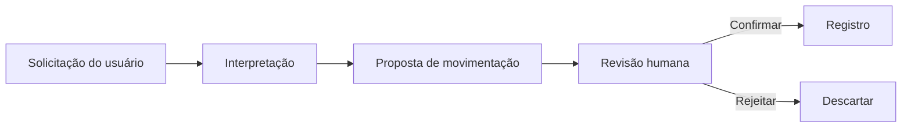

# LilHog — organização financeira com assistente de IA

Aplicativo de organização financeira pessoal com foco em iOS, em desenvolvimento. A proposta é reunir informações financeiras e facilitar o registro de movimentações com apoio de um assistente.

## Problema e solução

Registrar e acompanhar gastos exige manter informações organizadas e revisar lançamentos. O LilHog combina uma interface móvel de organização financeira com interpretação de texto para preparar propostas de movimentação.

## Minha atuação

Desenvolvimento do aplicativo e do assistente financeiro, conectando interface, dados locais e interpretação das solicitações do usuário.

## Onde entra a IA

O assistente prepara uma proposta estruturada a partir do texto. O usuário revisa os campos e confirma ou rejeita o lançamento antes de registrá-lo. O projeto também contém interpretação local baseada em regras, distinta de uma chamada a um modelo de IA.

O diagrama descreve o fluxo de interação, não uma evidência de execução online. Cálculos e registro financeiro permanecem separados da resposta do modelo.

## Estado e limitações

- Projeto em desenvolvimento, com código privado.
- Integrações online e comportamento em dispositivo precisam de demonstração própria.
- Sem comprovação apresentada de distribuição na App Store ou TestFlight.
- Sem métricas de uso por terceiros ou resultados aferidos.

## Demonstração planejada

Usar dados fictícios para mostrar a entrada de uma despesa, revisão da proposta, confirmação e atualização do painel. A gravação deverá identificar se a interpretação utilizou um modelo online ou regras locais e incluir também uma proposta rejeitada.

Não são expostos código privado, informações financeiras pessoais ou credenciais neste estudo de caso.

[Voltar ao perfil](../README.md)
