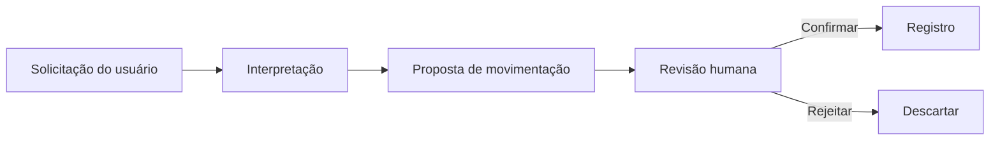

# LilHog — meu aplicativo de organização financeira

Estou desenvolvendo um aplicativo de organização financeira pessoal para iOS, com um assistente de IA para facilitar o registro de movimentações.

## A ideia

Quero reunir minhas informações financeiras em uma interface móvel e reduzir o trabalho de preencher cada lançamento manualmente. O assistente recebe uma solicitação em texto e prepara uma proposta que pode ser revisada antes do registro.

## O que estou desenvolvendo

Trabalho na interface, nos dados locais e no assistente financeiro. Organizei o fluxo para que o usuário possa confirmar ou rejeitar cada proposta.

Uso IA para ajudar na interpretação e mantenho os cálculos separados da resposta do modelo. Também tenho um modo de interpretação por regras locais, sem depender de um LLM no dispositivo.

## Como está hoje

O projeto continua em desenvolvimento e mantenho o código privado. Ainda estou validando as integrações online e o comportamento em iOS. Não publiquei uma versão na App Store ou no TestFlight, nem medi resultados de uso por outras pessoas.

## O que quero mostrar a seguir

Vou preparar uma demonstração com dados fictícios: registrar uma despesa, revisar a proposta do assistente, confirmar e acompanhar o painel. Também quero mostrar a rejeição de uma proposta, indicando quando a interpretação usa IA online ou regras locais.

[Voltar ao perfil](../README.md)
