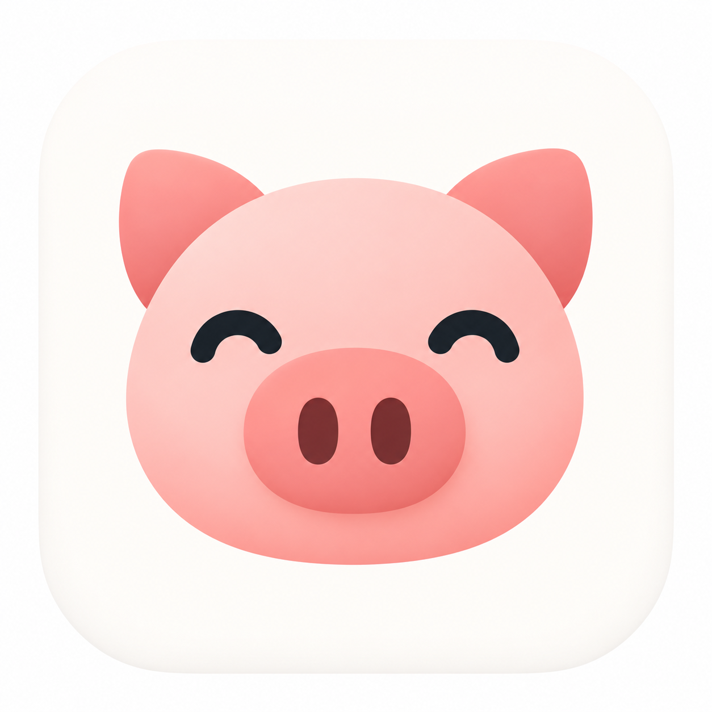
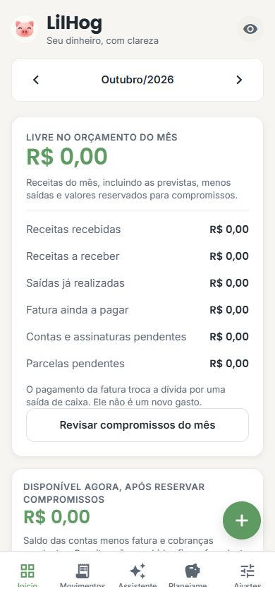
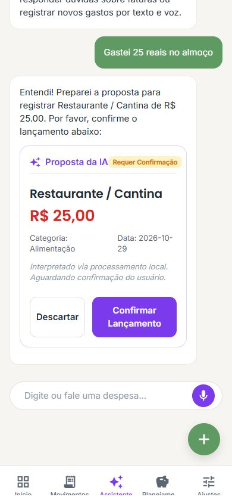
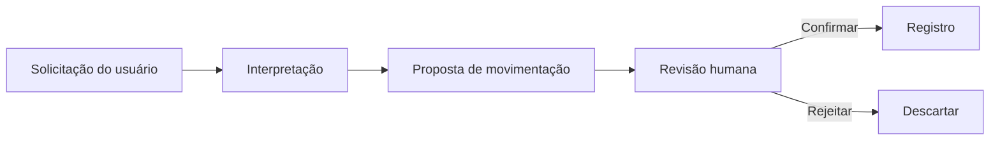

# LilHog — meu aplicativo de organização financeira

Estou desenvolvendo um aplicativo de organização financeira pessoal para iOS, com um assistente de IA para facilitar o registro de movimentações.

## Um pouco da interface

Capturei estas telas na versão web de desenvolvimento, em formato móvel de 390 × 844 pixels. Comecei com o banco vazio e usei uma solicitação fictícia no assistente.

<table>
  <tr>
    <th>Painel financeiro</th>
    <th>Proposta de movimentação</th>
  </tr>
  <tr>
    <td></td>
    <td></td>
  </tr>
</table>

No exemplo, digitei “Gastei 25 reais no almoço”. Usei a interpretação por regras locais, sem chamar uma API de IA, e deixei a proposta aguardando confirmação.

## A ideia

Quero reunir minhas informações financeiras em uma interface móvel e reduzir o trabalho de preencher cada lançamento manualmente. O assistente recebe uma solicitação em texto e prepara uma proposta que pode ser revisada antes do registro.

## O que estou desenvolvendo

Trabalho na interface, nos dados locais e no assistente financeiro. Organizei o fluxo para que o usuário possa confirmar ou rejeitar cada proposta.

Uso IA para ajudar na interpretação e mantenho os cálculos separados da resposta do modelo. Também tenho um modo de interpretação por regras locais, sem depender de um LLM no dispositivo.

## Como está hoje

O projeto continua em desenvolvimento e mantenho o código privado. Ainda estou validando as integrações online e o comportamento em iOS. Não publiquei uma versão na App Store ou no TestFlight, nem medi resultados de uso por outras pessoas.

## O que quero mostrar a seguir

Quero complementar as capturas com um vídeo do registro de uma despesa, mostrando a confirmação e a atualização do painel. Também pretendo demonstrar a rejeição de uma proposta e validar o fluxo com IA online e em um dispositivo iOS.

[Voltar ao perfil](../README.md)
